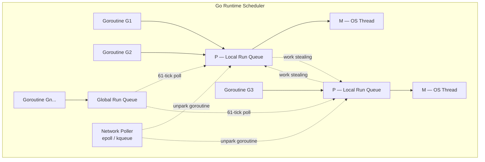
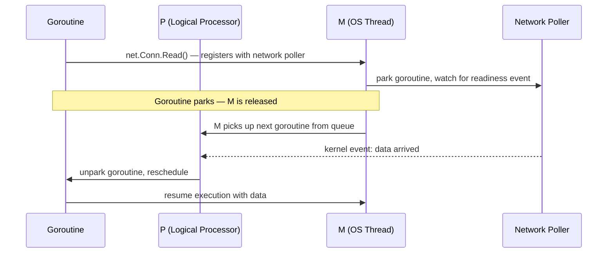
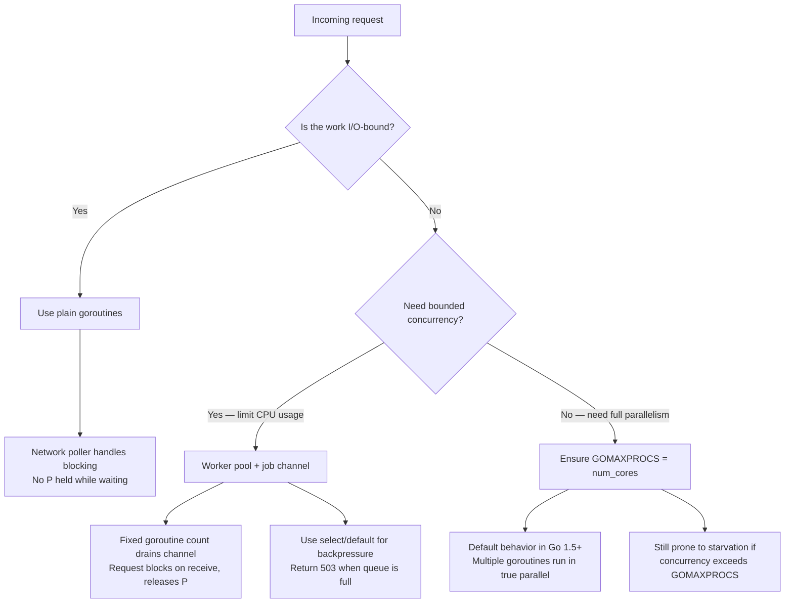

Go ships with a promise: goroutines are cheap. Create a million of them. The runtime handles the scheduling. Your server can handle ten thousand concurrent requests without breaking a sweat.

Run this server with `GOMAXPROCS=1` and hit `/compute` with 50 concurrent connections, each triggering a 100 ms CPU-bound loop. Then probe `/health` from a second terminal:

```bash
# Terminal 1
GOMAXPROCS=1 go run .

# Terminal 2 — apply load
wrk -t4 -c50 -d30s "http://localhost:3000/compute?strategy=goroutine"

# Terminal 3 — observe /health during load
wrk -t1 -c1 -d30s http://localhost:3000/health
```

The `/health` handler is three lines. It does no I/O, no computation. Its normal latency is under 2 ms. Under load from `/compute`, it climbs:

```
/health p50 latency: 103.42ms
/health p99 latency: 142.18ms
```

Go advertises goroutines as lightweight concurrent units. The language was built for concurrency. So why is a completely unrelated endpoint responding 70× slower than it should?

The answer has nothing to do with the code being wrong. It has everything to do with how the Go scheduler assigns work to processors — and what happens when you give it work it cannot preempt.

<GoSchedulerDiagram />

---

## First, what is a goroutine?

Before talking about schedulers, let's talk about where code actually runs.

An OS thread is the unit of execution your operating system manages. When you start a Go program, the OS gives it a process, and inside that process it creates threads. Each thread has its own stack — typically 8 MB on Linux. The OS scheduler decides when each thread runs, for how long, and when it gets preempted. You don't control this from user space.

Creating an OS thread is not free. The OS allocates memory for the stack, registers the thread with the scheduler, and context switches cost hundreds of nanoseconds. If you tried to create one OS thread per incoming HTTP request, you'd run out of memory long before you hit a thousand concurrent connections.

Go gives you a different unit: the goroutine.

```go
go handleRequest(conn) // spawns a goroutine, not an OS thread
```

A goroutine is a function that runs concurrently with other goroutines, managed entirely by the Go runtime — not the OS. It starts with a 2–8 KB stack (not 8 MB). The Go runtime can grow the stack dynamically if the goroutine needs more space. You can create hundreds of thousands of goroutines without breaking a sweat.

The `go` keyword is the only thing you need. No thread pool configuration, no executor, no async runtime setup. The runtime handles everything.

So how does the Go runtime run hundreds of thousands of goroutines when your machine only has 8 CPU cores?

---

## The Go scheduler: G, M, and P

The Go runtime uses what's called an M:N scheduler. That means it maps M goroutines onto N OS threads. Three components make this work.

A **G** is a goroutine — the unit of work. Every `go func()` creates one. Each G has its own stack and its own instruction pointer. When a G is ready to run, it sits in a queue and waits.

An **M** is an OS thread — the unit of execution. Ms are real threads managed by the operating system. The Go runtime maintains a pool of them. An M can only run one goroutine at a time.

A **P** is a logical processor — the resource that connects Gs to Ms. A P holds a local run queue of goroutines. An M must hold a P before it can execute any G. The number of Ps is set by `GOMAXPROCS`, and that number determines how many goroutines can run in true parallel.



When you start the experiment server, it logs the current values:

```
GOMAXPROCS        : 8
Logical CPU cores : 8
Listening on http://0.0.0.0:3000
```

With `GOMAXPROCS=8`, the runtime creates 8 Ps. Up to 8 goroutines can run in true parallel — one per P, each on its own M. When you set `GOMAXPROCS=1`, there's only one P. Every goroutine lines up in a single queue, and only one runs at a time.

That's the key to understanding the starvation we saw in the opening. With one P, every goroutine competing for CPU time — including the `/health` handler — waits in the same queue behind whatever is currently running.

But that raises another question. Node.js handles concurrency fine with a single thread. Why can't Go do the same?

---

## What goes wrong when a goroutine won't yield

Node.js uses an event loop — a single thread that explicitly yields control between I/O operations. When your callback awaits a database response, the event loop runs other callbacks until the data arrives. The yield is explicit and mandatory.

Go goroutines work differently. The Go scheduler is *cooperative at function call boundaries*. This means goroutines yield to the scheduler when they call a function — specifically, the scheduler inserts yield points at function prologues. This is called asynchronous preemption and was introduced in Go 1.14.

But here's what matters for our scenario: a tight CPU loop with no function calls has no yield points.

```go
func runBlockingWork() {
    start := time.Now()
    deadline := start.Add(100 * time.Millisecond)
    for time.Now().Before(deadline) {
        // tight loop — no yield point, no I/O, no channel op
    }
}
```

Each call to `time.Now()` is a function call, so modern Go can technically preempt here. But even with asynchronous preemption, running 50 goroutines that each busy-wait for 100 ms on a machine with `GOMAXPROCS=1` creates a problem: there is only one P.

The `/compute` handler is dispatched directly to the request's goroutine:

```go
case "goroutine":
    start := time.Now()
    runBlockingWork()           // 100ms busy-wait — HOLDS THE P
    durationMs := time.Since(start).Milliseconds()
```

There's no `.await`, no channel receive, no yield. The goroutine running this handler occupies the P for the full 100 ms. With 50 concurrent requests and `GOMAXPROCS=1`, there's only one P available. All 50 goroutines queue up. The `/health` handler is waiting in that same queue with no P available to run it.

That's **scheduler starvation**. No bug. No race condition. Just a P with no capacity left.

Here's what the benchmark shows under these conditions:

| Strategy | GOMAXPROCS | /health p99 | /compute RPS | Error rate |
|---|---|---|---|---|
| `goroutine` | 1 | >100 ms | ~8 req/s | 0% |
| `goroutine` | num_cores | ≤10 ms | ~300 req/s | 0% |

> **⚠ Warning: Goroutine Leaks Are Silent**
>
> A goroutine blocked forever on a channel receive that never gets a sender consumes memory indefinitely. There are no warnings, no panics, no GC intervention. Always ensure every job sent into a worker channel has a corresponding receiver, or use `select` with a `ctx.Done()` case to give the goroutine an escape path.

---
## Channels and the worker pool pattern

The fix for scheduler starvation is to move the CPU-bound work off the request goroutine and into a fixed pool of worker goroutines. The request goroutine blocks on a channel receive while waiting, which releases the P.

A channel in Go is a typed conduit for passing values between goroutines. An unbuffered channel blocks the sender until a receiver is ready. A buffered channel accepts values up to its capacity without blocking.

When a goroutine blocks on a channel receive — waiting for a value that hasn't arrived yet — the Go runtime parks it. The goroutine stops running, releases its P, and the P picks up another goroutine from its queue. No OS thread is held.

That's the mechanism that makes the worker pool pattern work.

### The workerpool strategy

Four worker goroutines are started at server boot, each draining a shared job channel:

```go
func worker(jobs <-chan jobRequest) {
    for req := range jobs {
        start := time.Now()
        runBlockingWork()
        req.result <- jobResult{
            durationMs:  time.Since(start).Milliseconds(),
            goroutineID: goroutineID(),
        }
    }
}
```

The handler dispatches work to the pool and blocks on the result:

```go
case "workerpool":
    req := jobRequest{result: make(chan jobResult, 1)}
    state.workerJobs <- req          // send job to pool — non-blocking, large buffer
    res := <-req.result              // block on receive — releases P while waiting
```

The handler goroutine parks on `<-req.result`. The P is free to run `/health` or any other goroutine. When a worker finishes, it sends the result back, which unparks the handler.

With 4 workers and a 100 ms busy-wait, throughput is capped at ~40 req/s. That's the trade-off: you limit CPU concurrency to keep the scheduler free.

### The bounded strategy

The `workerpool` strategy uses a large channel buffer (1000) so requests never get rejected. The `bounded` strategy caps the queue at 20 and rejects excess requests immediately:

```go
case "bounded":
    req := jobRequest{result: make(chan jobResult, 1)}
    select {
    case state.boundedJobs <- req:  // non-blocking send — dispatched to worker
        res := <-req.result
    default:                         // channel is full — return 503 immediately
        w.WriteHeader(http.StatusServiceUnavailable)
        json.NewEncoder(w).Encode(ErrorResponse{Error: "Server overloaded: job queue full"})
    }
```

The `select` with a `default` case is how Go does non-blocking channel operations. If `state.boundedJobs` has room, the job is sent. If it's full, the `default` branch fires and the caller gets a 503.

This gives you backpressure: the server rejects work it can't handle instead of queuing it indefinitely.

| Strategy | CPU concurrency | /health impact | Backpressure |
|---|---|---|---|
| `goroutine` | Unlimited (one per request) | Starvation under GOMAXPROCS=1 | None — all requests queue |
| `workerpool` | Bounded (4 workers) | ≤5 ms p99 regardless of GOMAXPROCS | None — large buffer absorbs spikes |
| `bounded` | Bounded (4 workers) | ≤5 ms p99 regardless of GOMAXPROCS | 503 on queue full — excess requests rejected |

---

## Go vs. Node.js and Rust — a quick comparison

If you've read the [Node.js event loop article](/writing/nodejs-single-threaded) or the [Rust/Tokio async runtime article](/writing/rust-async-runtime), the patterns here will look familiar. All three runtimes face the same problem: how to run concurrent work without blocking the scheduler. They solve it differently.

### Goroutines vs Tokio async tasks

Go's goroutines and [Tokio's](/writing/rust-async-runtime) async tasks are both lightweight units scheduled by a user-space runtime onto a fixed pool of OS threads. The key difference: goroutines have their own growable stack (starting at 2–8 KB), while Tokio tasks are stackless state machines generated by the compiler. A goroutine can call functions recursively and hold local state on its stack. A Tokio task stores its state in a generated struct and resumes from where it left off.

### Worker pool vs spawn_blocking

Go's worker pool pattern — goroutines consuming jobs from a buffered channel — is the idiomatic equivalent of Tokio's `spawn_blocking` with a `Semaphore`. Both mechanisms exist to bound concurrent CPU-heavy work and prevent scheduler starvation.

```go
// Go: worker pool with bounded channel
jobs := make(chan Job, 20)
for i := 0; i < 4; i++ {
    go worker(jobs) // fixed pool of 4 goroutines
}
jobs <- job // bounded send — 503 on full via select/default
```

```rust
// Rust: spawn_blocking with Semaphore
let sem = Arc::new(Semaphore::new(4)); // limit to 4 concurrent
let permit = sem.clone().acquire_owned().await?;
tokio::task::spawn_blocking(move || { // offload to blocking pool
    compute_hash(data)
});
```

### GOMAXPROCS vs UV_THREADPOOL_SIZE

[Node.js](/writing/nodejs-single-threaded) has `UV_THREADPOOL_SIZE=4` — a fixed thread pool for synchronous operations that cannot run on the event loop. Go has no equivalent because goroutines are not OS threads. `GOMAXPROCS` controls the maximum number of OS threads running goroutines simultaneously — it sets the parallelism ceiling, not a thread pool size. The Go runtime creates and destroys OS threads as needed, bounded by GOMAXPROCS.

| Dimension | Go | Node.js | Rust/Tokio |
|---|---|---|---|
| Scheduler thread model | M:N (goroutines → Ps → Ms) | Single-threaded event loop | M:N (tasks → worker threads) |
| CPU-bound handler with no yield | Holds a P, starves others | Blocks the event loop entirely | Holds a worker thread, starves others |
| Idiomatic fix for CPU-heavy work | Worker pool + buffered channel | Offload to worker_threads or child process | `spawn_blocking` + Semaphore |
| Default parallelism unit | GOMAXPROCS (= num CPU cores) | 1 (single thread) | num_cpus (worker threads) |

---

## Benchmark Results

> **Expected outcomes** — replace with measured values after running the benchmarks in the [experiment README](https://github.com/huyhoang1001/underhood/tree/main/experiments/golang-goroutines). Run with `wrk -t4 -c50 -d30s` on a single machine.

### GOMAXPROCS=1

| Strategy | /health p50 | /health p99 | /compute throughput | Error rate |
|---|---|---|---|---|
| `goroutine` | ~50 ms | >100 ms | ~8 req/s | 0% |
| `workerpool` | \<2 ms | ≤5 ms | ~40 req/s | 0% |
| `bounded` | \<2 ms | ≤5 ms | ~40 req/s | varies |

### GOMAXPROCS=num_cores

| Strategy | /health p50 | /health p99 | /compute throughput | Error rate |
|---|---|---|---|---|
| `goroutine` | \<2 ms | ≤10 ms | ~300 req/s | 0% |
| `workerpool` | \<2 ms | ≤5 ms | ~40 req/s | 0% |
| `bounded` | \<2 ms | ≤5 ms | ~40 req/s | varies |

The `goroutine` strategy's throughput difference between GOMAXPROCS=1 and num_cores is striking: ~8 req/s vs ~300 req/s. With a single P, goroutines queue sequentially. With 8 Ps, 8 goroutines run the busy-wait in true parallel.

The `workerpool` and `bounded` strategies show the same performance regardless of GOMAXPROCS: 4 workers cap CPU concurrency. The scheduler stays free.

### Why I/O-bound goroutines don't have this problem

There's an important distinction: I/O-bound goroutines don't hold a P while waiting. The network poller handles that.



A goroutine waiting on a network read parks itself, releases its P, and the P immediately picks up something else. When the data arrives, the network poller unparks the goroutine and puts it back in the queue.

This is why Go handles ten thousand concurrent network connections on a handful of OS threads. I/O-waiting goroutines consume essentially no resources while parked.

The problem only arises when goroutines do CPU work without yielding — which brings us to the decision guide.

---

## The production decision guide

When you're writing Go services that handle concurrent requests, the choice of concurrency pattern depends on what kind of work each request does.



**Rules of thumb:**

- **I/O-bound work** (database queries, HTTP calls, file reads via `net.Conn`): use plain goroutines. The network poller parks the goroutine and releases the P. No special handling needed.
- **CPU-bound work with bounded concurrency needs**: use a worker pool draining a buffered channel. The pool size caps CPU concurrency. The request goroutine parks on a channel receive and releases its P.
- **CPU-bound work with true parallelism needs**: ensure `GOMAXPROCS` equals the number of available CPU cores (the default since Go 1.5). Multiple goroutines can run in true parallel across cores. But if your concurrency exceeds GOMAXPROCS, you're back to queueing.

Goroutines are cheap. A P is not. CPU-bound work without yield points holds a P and starves everything queued on it. The worker pool pattern — four goroutines draining a channel — bounds this by keeping CPU concurrency fixed and letting the scheduler breathe.
