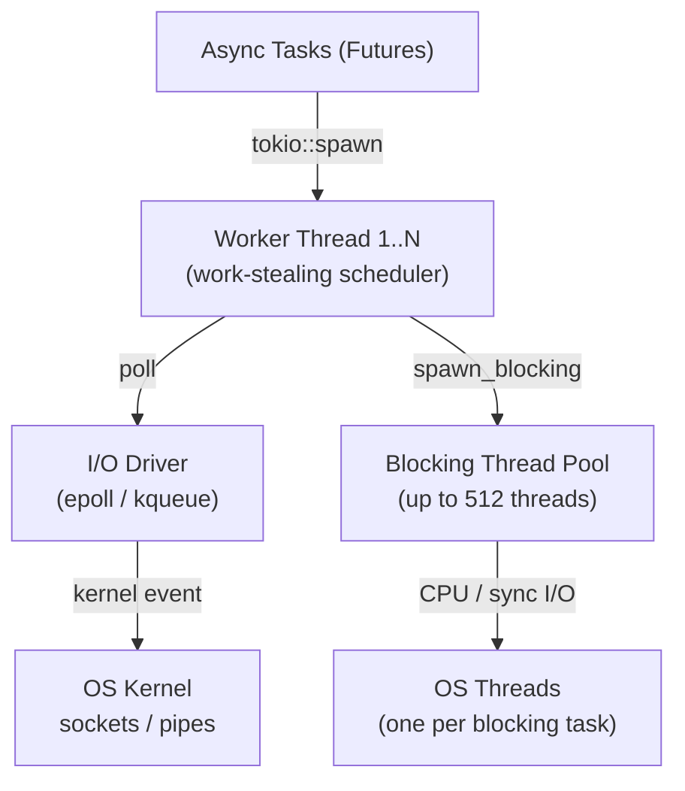
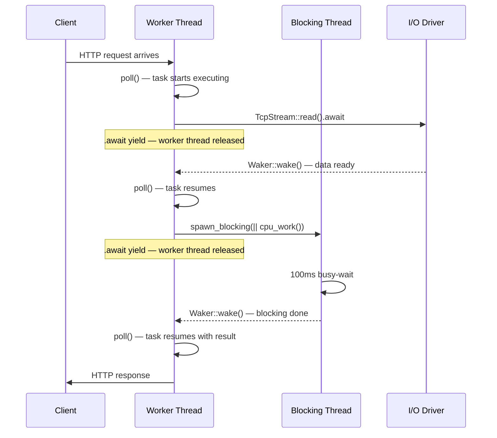
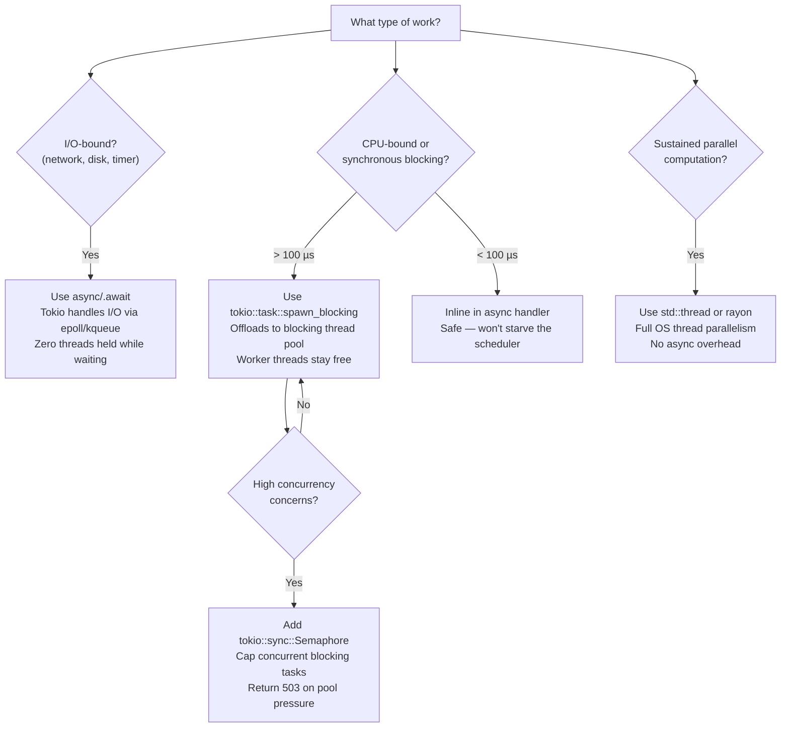

Every Rust engineer has heard the pitch: *"Rust's async is zero-cost — your code compiles to state machines with no runtime overhead."*

We repeat it in architecture discussions. We cite it when justifying Rust over Go or Node.js. We nod along when benchmarks show Axum handling hundreds of thousands of requests per second.

And yet, run this Axum server under load with `strategy=blocking`:

```bash
wrk -t4 -c50 -d30s http://localhost:3000/compute?strategy=blocking
```

and simultaneously probe the health endpoint from a second terminal:

```bash
wrk -t1 -c1 -d30s http://localhost:3000/health
```

You observe something that shouldn't be possible:

```
/health p50 latency:  312.45ms
/health p99 latency:  487.22ms
```

The `/health` handler is three lines of Rust. It does no I/O, no computation. Its normal latency is 2 ms. Under load from `/compute`, it climbs to 300–500 ms.

Why does one endpoint's slow work make a completely unrelated endpoint slow?

The answer has nothing to do with the code being wrong. It has everything to do with how Tokio schedules work — and what happens when you give it work it wasn't designed to handle.

<TokioArchitectureDiagram />

---

## First, what is a thread?

Before anything else: Tokio runs on OS threads. A thread is where code actually executes. Your CPU has a fixed number of cores, and each core can run one thread at a time.

When you start an Axum server with `#[tokio::main]`, Tokio creates a pool of OS threads — by default, one per logical CPU core. On an 8-core machine, that's 8 threads.

```rust
// Logged at server startup in our experiment:
Tokio worker threads  : 8
Tokio blocking threads: up to 512 (Tokio default ceiling)
Listening on http://0.0.0.0:3000
```

These 8 threads are shared across every incoming request. They're called **worker threads**. Everything async runs on them.

---

## Does Rust have an event loop?

Sort of — but it works differently from Node.js, and understanding the difference matters.

### In Node.js

Node.js has one main thread. That thread runs your JavaScript, processes I/O callbacks, and handles all incoming requests. When you await a database query, Node pauses your function and runs other callbacks until the response arrives. Everything goes through that single thread.

### In Rust with Tokio

Rust doesn't have a built-in event loop. The `async`/`await` keywords are just syntax — they tell the compiler to transform your function into something that can be paused and resumed, but they don't provide any machinery to actually run it.

That machinery is Tokio. When you write:

```rust
async fn fetch_user(id: u64) -> User {
    let row = db.query_one("SELECT ...", &[&id]).await?;
    User::from_row(row)
}
```

The compiler turns this into a struct that remembers where it left off between pauses. That struct does nothing on its own. Tokio is what picks it up, runs it, pauses it when it hits `.await`, and resumes it when the data is ready.

Tokio does this across multiple worker threads running in parallel — not on a single thread like Node.js. Each worker thread independently picks up tasks and runs them. When a task hits an `.await` point and needs to wait, the worker moves on to run something else.

---

## Part 1: How Tokio actually runs your code

### Worker threads and async tasks

An **async task** is just a unit of work you've given to Tokio — usually created with `tokio::spawn`. Tokio maintains a queue of tasks waiting to run, and each worker thread pulls from that queue.

Here's the key behaviour: when a task reaches an `.await` point, it *pauses* and the worker thread is free to run a different task. The original task sits idle, taking up no thread, until the thing it was waiting for is ready.

This is how 8 worker threads can serve thousands of concurrent requests. Most of the time, most tasks are waiting — for a database, a network response, a timer. The worker threads are free to handle other requests while they wait.

### How Tokio knows when a task is ready again

When a task pauses at `.await`, it registers a **waker** — a small callback that says "when this I/O completes, wake me up." Tokio's I/O driver watches the OS for these events (using epoll on Linux, kqueue on macOS). When the kernel says "data arrived on socket #42", the I/O driver calls the waker, which puts the task back in the run queue.

This is the whole mechanism. No magic, no polling loops — just tasks pausing, wakers firing, tasks resuming.



### What work-stealing means

Each worker thread has its own local task queue. When a thread runs out of work, it reaches over and steals tasks from another thread's queue. This keeps all cores busy without a central bottleneck.

It also means there's no global task queue to fight over. The design scales well under load.

---

## Part 2: What goes wrong when you block a worker thread

Here is the `blocking` strategy handler from our experiment:

```rust
"blocking" => {
    let thread_id = format!("{:?}", std::thread::current().id());
    let start = Instant::now();
    run_blocking_work(); // 100ms busy-wait — RUNS ON THE ASYNC WORKER THREAD
    let duration_ms = start.elapsed().as_millis() as u64;
    Ok(Json(ComputeResponse {
        strategy: "blocking".into(),
        duration_ms,
        thread_id,
    }))
}
```

And `run_blocking_work()`:

```rust
fn run_blocking_work() {
    let deadline = Instant::now() + Duration::from_millis(100);
    let mut _x: u64 = 0;
    while Instant::now() < deadline {
        _x = _x.wrapping_add(1);
    }
}
```

This code is correct Rust. It compiles. `cargo clippy` is happy. But it has a serious problem: it runs for 100ms without ever pausing.

There's no `.await` inside `run_blocking_work()`. That means the worker thread running this handler is occupied for the full 100ms and can't do anything else. It can't run `/health`. It can't process other requests. It just sits there spinning.

With 8 worker threads and 50 concurrent requests, all 8 threads get tied up almost immediately. Every thread is running a 100ms busy-wait. The `/health` handler is waiting in the queue with no thread available to run it.

That's **scheduler starvation**. No bug. No race condition. Just a worker pool with no capacity left.

**What the benchmark shows (blocking strategy, 50 concurrent connections):**

| Metric                | Baseline (1 req) | Under load (50 concurrent) |
| --------------------- | ---------------- | -------------------------- |
| `/health` p50 latency | ~2 ms            | >100 ms                    |
| `/health` p99 latency | ~3 ms            | >300 ms                    |
| `/compute` throughput | ~8 req/s         | ~8 req/s                   |
| `/compute` error rate | 0%               | 0%                         |

> *Expected outcomes on an 8-core machine. Run the benchmarks in the README to get measured values.*

Notice that `/compute` throughput doesn't change — the server is still doing the same amount of compute work. What changes is that `/health` can't get a turn.

> **⚠ Warning: `spawn_blocking` Is Not Free**
>
> Calling `tokio::task::spawn_blocking` on every incoming request isn't safe either.
> Each call consumes a thread from Tokio's blocking thread pool (default ceiling: 512 threads).
> If the pool fills up, `spawn_blocking` itself will block the calling task while it waits for a free thread.
> The bounded strategy with `tokio::sync::Semaphore` shown in Part 3 is the safer pattern for high-concurrency workloads.

---

## Part 3: spawn_blocking — moving work off the worker threads

So why can't Tokio just run long-running work on a background thread automatically?

It could — but it doesn't know which work is "long" and which isn't. That's your job. When you have CPU-heavy or blocking work that doesn't have `.await` points, you tell Tokio explicitly: *"run this on a different thread."*

That's `spawn_blocking`. It takes a closure, hands it to a separate thread pool, and returns a future you can `.await`. While the blocking work runs, the worker thread is free.

```rust
"spawn_blocking" => {
    let (duration_ms, thread_id) = tokio::task::spawn_blocking(|| {
        let inner_start = Instant::now();
        let tid = format!("{:?}", std::thread::current().id());
        run_blocking_work(); // runs on a BLOCKING POOL thread, not a worker thread
        (inner_start.elapsed().as_millis() as u64, tid)
    })
    .await   // worker thread is RELEASED here — free to run /health, other requests
    .unwrap();
    // ...
}
```

The worker thread hands off the work, hits `.await`, and immediately goes back to the queue. It might handle five other requests while `run_blocking_work()` is running on the blocking pool thread.

### The bounded pattern

If many requests all use `spawn_blocking` simultaneously, you can flood the blocking thread pool. The `bounded` strategy adds a `tokio::sync::Semaphore` — a simple counter that limits how many blocking tasks run at once:

```rust
"bounded" => {
    let permit = tokio::time::timeout(
        Duration::from_secs(30),
        state.semaphore.acquire(),   // wait for a slot (max 4 concurrent)
    )
    .await;

    let permit = match permit {
        Ok(Ok(p)) => p,
        _ => return Err((StatusCode::SERVICE_UNAVAILABLE, Json(ErrorResponse {
            error: "Server overloaded: semaphore permit not acquired within 30s".into(),
        }))),
    };

    let (duration_ms, thread_id) = tokio::task::spawn_blocking(|| {
        run_blocking_work();
        // ...
    }).await.unwrap();
    drop(permit); // release the slot when done
    // ...
}
```

If more than 4 requests arrive simultaneously, they wait for a slot. After 30 seconds of waiting, they get a 503 instead of queuing forever.

**Comparison:**

| Dimension                          | `blocking` (direct)              | `spawn_blocking`                            |
| ---------------------------------- | -------------------------------- | ------------------------------------------- |
| Worker thread held during CPU work | Yes — full 100 ms                | No — released at `.await`                   |
| Impact on `/health` and other tasks | Starves them                    | None — workers stay free                    |
| Worker threads consumed            | 1 per request (while running)    | 0 async workers; 1 blocking pool thread     |
| When to use                        | Work under ~100 µs               | Anything slower than ~100 µs                |

---

## Part 4: Tokio vs. Node.js — a quick comparison

If you've read the [companion Node.js article](/writing/nodejs-single-threaded), you've seen a similar story play out with libuv's thread pool. The analogy is fairly direct.

In Node.js, `crypto.pbkdf2` runs on a background thread from libuv's pool, and the callback runs on the main thread when it's done:

```javascript
crypto.pbkdf2('password', 'salt', 100000, 64, 'sha512', (err, key) => {
  // runs on a libuv worker thread
  // callback fires on the main thread when done
  res.json({ hash: key.toString('hex') });
});
```

In Rust with Tokio, the same pattern looks like:

```rust
let key = tokio::task::spawn_blocking(|| {
    derive_key("password", "salt", 100_000)  // runs on a blocking pool thread
})
.await?;
// resumes on a worker thread when done
```

Both approaches do the same thing: hand the CPU work to a separate thread pool so the main scheduling threads stay free.

The main differences:

| Dimension                                | Node.js                                           | Tokio (Rust)                                            |
| ---------------------------------------- | ------------------------------------------------- | ------------------------------------------------------- |
| Async execution thread model             | Single main thread (Event Loop)                   | N worker threads (default: num_cpus)                    |
| Consequence of blocking a thread         | Blocks all JS, all I/O callbacks, all timers      | Blocks that worker's queue only; others continue        |
| Blocking work pool                       | Fixed: `UV_THREADPOOL_SIZE=4` by default          | Dynamic: grows up to 512 threads                        |

The bigger pool in Tokio means accidental blocking is less immediately visible — but it's still a problem. The `/health` starvation we measured is real, and it happens on Tokio even though its pool is much larger than Node's.

---

## Part 5: Benchmark Results

> *All values are expected outcomes based on an 8-core machine. Run the benchmarks described in the README to replace these with your measured values.*

| Strategy         | /health p50 | /health p99 | /compute throughput | Error rate                     |
| ---------------- | ----------- | ----------- | ------------------- | ------------------------------ |
| `blocking`       | >100 ms     | >300 ms     | ~8 req/s            | ~0%                            |
| `spawn_blocking` | ≤2 ms       | ≤5 ms       | ~8 req/s            | ~0%                            |
| `bounded`        | ≤2 ms       | ≤5 ms       | ~4 req/s            | ~0% (503s counted separately)  |

Both `blocking` and `spawn_blocking` produce the same `/compute` throughput. The only difference is what happens to everything else running on the server.

### Request Execution Timeline

This diagram shows what happens inside Tokio when a request uses `spawn_blocking` correctly. Notice that the worker thread is free between the two `.await` points — that's the window where `/health` and other requests can run.



---


## Part 6: When spawn_blocking isn't enough — rayon and true parallelism

`spawn_blocking` solves the problem we measured: it moves a blocking task off the worker thread so other async tasks can run. But it only runs one closure at a time, on one thread.

What if the work itself is the bottleneck — not the blocking, but the sheer amount of computation?

Imagine you're resizing a 50-megapixel image. `spawn_blocking` would move that work off the async thread, which is good. But it would still run on a single thread from start to finish. All those pixels are processed sequentially, one after another.

If you have 8 cores available and the image can be divided into chunks, you're leaving 7 cores idle.

That's the problem `rayon` solves. Rayon is a parallel computation library that takes a piece of work, splits it across all available CPU cores, and joins the results when everything finishes. It's not part of the async runtime — it's a completely separate thread pool, designed specifically for divide-and-conquer CPU work.

### A concrete example: processing a large collection

Say you receive a batch of 10,000 records and need to hash each one. The sequential version:

```rust
// processes one record at a time — ignores 7 out of 8 cores
let hashes: Vec<String> = records
    .iter()
    .map(|r| compute_hash(r))
    .collect();
```

The parallel version with rayon:

```rust
use rayon::prelude::*;

// automatically splits the work across all CPU cores
let hashes: Vec<String> = records
    .par_iter()         // parallel iterator — this is the only change
    .map(|r| compute_hash(r))
    .collect();
```

That's it. `.par_iter()` replaces `.iter()`. Rayon handles splitting the slice, scheduling chunks across the thread pool, and collecting the results. On an 8-core machine, you get roughly 8x the throughput for embarrassingly parallel work like this.

### How rayon fits with Tokio

Rayon and Tokio don't conflict — they just each own their own thread pool.

The typical pattern when combining them: receive a request on a Tokio worker thread, hand the CPU-heavy work to rayon via `spawn_blocking`, and await the result:

```rust
axum::handler!(|payload: Bytes| async move {
    let result = tokio::task::spawn_blocking(move || {
        // inside here, rayon can use all cores
        payload
            .par_chunks(CHUNK_SIZE)
            .map(|chunk| compress_chunk(chunk))
            .collect::<Vec<_>>()
    })
    .await?;

    Ok(Json(result))
})
```

The `spawn_blocking` keeps the Tokio worker thread free. Rayon does the parallel work on its own pool. Neither runtime knows about the other — they just coexist.

### When to use rayon vs spawn_blocking

The distinction comes down to one question: **is the work already parallelisable?**

| Situation | Use |
|---|---|
| One blocking operation (password hash, file read, legacy API call) | `spawn_blocking` |
| A collection you can process independently in chunks | `rayon::par_iter()` |
| Image processing, video encoding, compression | `rayon` or a dedicated worker thread |
| Embedding generation, model inference | Dedicated thread(s) with `std::thread::spawn` |
| Anything mixing parallel CPU work + async results | `spawn_blocking` wrapping rayon |

The rule of thumb: if you're calling `.iter().map(expensive_fn).collect()` and the function is pure (no I/O, no shared mutable state), replace `.iter()` with `.par_iter()` and you're done. If you have one big blocking operation with no natural subdivision, `spawn_blocking` is the right tool.

### What about spawning OS threads directly?

`std::thread::spawn` is an option when you need a long-lived thread with its own lifecycle — a background worker that runs continuously, reads from a channel, and processes items one by one. It's not a task scheduler like Tokio or a parallel computation framework like rayon. It's just an OS thread you manage yourself.

```rust
// background processing thread — runs for the lifetime of the application
let (tx, rx) = std::sync::mpsc::channel::<WorkItem>();

std::thread::spawn(move || {
    for item in rx {
        process(item);  // runs on its own dedicated thread
    }
});
```

This pattern makes sense for things like a background indexer, a metrics flusher, or a queue consumer that shouldn't be tied to the request lifecycle. For one-off parallel computation, rayon is simpler. For occasional blocking operations, `spawn_blocking` is simpler. Direct `std::thread` is for when you need explicit control over the thread's lifetime.

## Part 7: The production decision guide

When you're writing an async Rust handler and need to decide how to handle some work:



**A few rules of thumb:**

- If work involves waiting (network, disk, database) — just `.await` it. Tokio's I/O driver handles it without holding any thread.
- If work is synchronous and takes more than ~100 µs — use `spawn_blocking`. Anything slower than that is long enough to noticeably delay other tasks.
- If you're running many `spawn_blocking` calls under heavy traffic — add a `Semaphore` to cap concurrency and return 503 early rather than letting the blocking pool grow without bound.
- If you need true parallelism for CPU-heavy computation (image processing, compression, ML inference) — `std::thread` or `rayon` are better fits than trying to work around the async runtime.

Tokio's default worker thread count is `std::thread::available_parallelism()` — the number of logical CPU cores. You rarely need to change it for I/O-heavy servers. For CPU-bound workloads, `spawn_blocking` takes the pressure off.

---

## Conclusion: the mental model that actually works

The opening problem — `/health` latency spiking to 300 ms despite doing no work — comes down to one thing: Tokio's worker threads are shared across all async tasks, and a synchronous blocking call holds a worker thread for its entire duration without pausing.

With 8 worker threads and 50 concurrent 100ms blocking requests, the math is straightforward: all workers are busy. `/health` can't run until one of them finishes.

The working mental model: **Tokio's worker threads are a shared resource. Blocking work that doesn't pause wastes that resource for everyone.**

`spawn_blocking` fixes it cleanly: the blocking work moves to a separate thread pool, the worker thread is released at the `.await`, and the rest of the server stays responsive.

- **I/O, timers, channels** — use `.await` and let Tokio handle it
- **CPU-heavy or blocking work over ~100 µs** — use `spawn_blocking`
- **Independent parallel computation** — use `std::thread` or `rayon`
