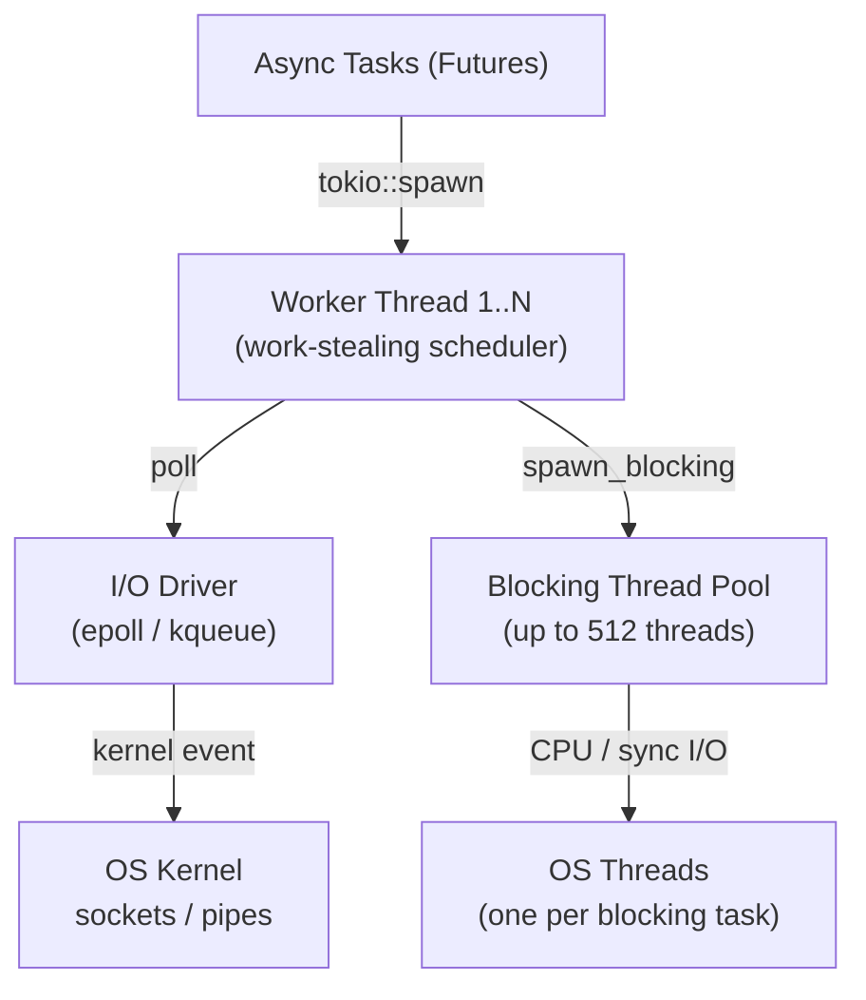
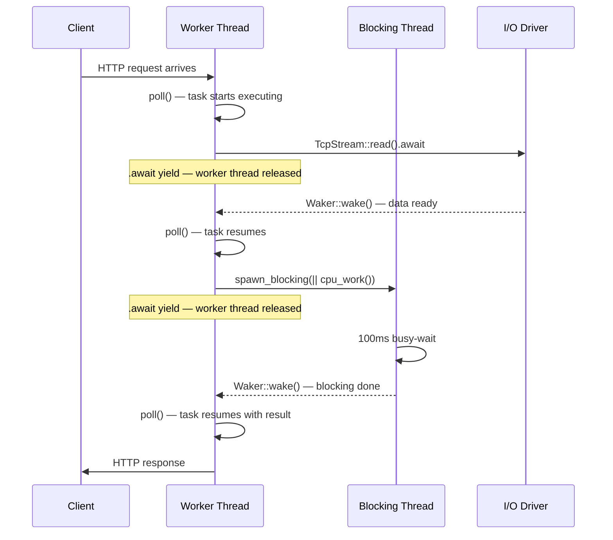
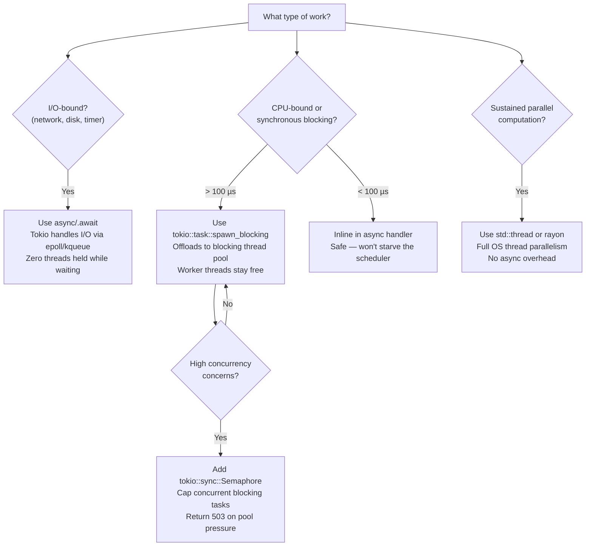

Every Rust engineer has heard the pitch: *"Rust's async is zero-cost — your code compiles to state machines with no runtime overhead."*

We repeat it in architecture discussions. We cite it when justifying Rust over Go or Node.js. We nod along when benchmarks show Axum handling hundreds of thousands of requests per second.

And yet, if you run this Axum server under load with `strategy=blocking`:

```bash
wrk -t4 -c50 -d30s http://localhost:3000/compute?strategy=blocking
```

and simultaneously probe the health endpoint from a second terminal:

```bash
wrk -t1 -c1 -d30s http://localhost:3000/health
```

you observe something that shouldn't be possible:

```
/health p50 latency:  312.45ms
/health p99 latency:  487.22ms
```

The `/health` handler is three lines of Rust. It does no I/O, no computation, no allocation beyond a JSON response. Its baseline latency is **2 ms**. Under load from `/compute`, it degrades to **300–500 ms**.

The question the benchmark forces: *"Why does a pure async Rust server become unresponsive when one endpoint blocks — even though the two endpoints share nothing?"*

<TokioArchitectureDiagram />

---

## Does Rust Have an Event Loop?

The honest answer is: it depends on which layer you're asking about.

### The Language Layer: async/await as Zero-Cost Syntax

Rust's `async` and `await` keywords are purely syntactic. When the compiler sees:

```rust
async fn fetch_user(id: u64) -> User {
    let row = db.query_one("SELECT ...", &[&id]).await?;
    User::from_row(row)
}
```

it desugars this into a state machine — an anonymous struct that implements the `Future` trait. The struct encodes every suspension point (each `.await`) as an enum variant that stores only the local variables in scope at that moment. No heap allocation, no OS thread, no runtime overhead until execution actually begins.

The language provides the syntax and the trait. It provides **nothing else**. There is no built-in executor, no built-in I/O driver, no built-in thread pool. A Rust `Future` without a runtime is an inert state machine that will never advance.

### The Runtime Layer: Tokio as the Executor

Tokio is a user-space library that provides what the language deliberately omits:

1. A **multi-threaded work-stealing scheduler** (the async executor)
2. An **I/O driver** integrated with the OS kernel event notification system
3. A **blocking thread pool** for synchronous work that cannot yield

When you annotate `main` with `#[tokio::main]`, you are telling the compiler to wrap your async function in a `tokio::runtime::Runtime::block_on` call. That runtime boots `N` worker threads (where `N` defaults to `std::thread::available_parallelism()`), registers an I/O driver with the OS, and starts polling tasks.

There is no "event loop" in the Node.js sense — a single-threaded while loop checking phases. There are `N` threads all running their own polling loops in parallel, stealing tasks from each other's queues when idle.

---

## Part 1: Tokio's Internal Architecture

### Worker Threads

When the Tokio runtime starts, it creates `N` OS threads equal to the number of logical CPU cores. Each thread runs an identical loop:

1. Poll all tasks in its **local run queue**
2. If the local queue is empty, **steal tasks** from sibling worker queues
3. If all queues are empty, park and wait for a Waker notification

```rust
// What main() logs at startup in our experiment server:
Tokio worker threads  : 8
Tokio blocking threads: up to 512 (Tokio default ceiling)
Listening on http://0.0.0.0:3000
```

### Per-Thread Task Queues and Work Stealing

Each worker thread has a **lock-free double-ended queue (deque)**. When `tokio::spawn` is called, the new task is pushed to the calling thread's local queue. Idle workers steal from the **back** of busy workers' queues, ensuring even distribution without a centralised lock.

### The I/O Driver

Tokio integrates the OS event notification system (epoll on Linux, kqueue on macOS, IOCP on Windows) directly into the scheduler. When a task calls `.await` on a `TcpStream::read()`, Tokio registers interest with the kernel and immediately suspends the task — no thread is held. When data arrives, the kernel notifies the I/O driver, which calls `Waker::wake()` to reschedule the task.

A single worker thread can manage tens of thousands of suspended network connections without consuming additional OS resources.

### The Poll Model and Wakers

Every `Future` exposes a single method:

```rust
fn poll(self: Pin<&mut Self>, cx: &mut Context<'_>) -> Poll<Output>
```

When called, the future either:

* Returns `Poll::Ready(value)` — computation is complete
* Returns `Poll::Pending` — registers `cx.waker().clone()` somewhere that will call `wake()` when progress is possible, then returns

The critical rule: **a future that returns `Poll::Pending` must never re-enter `poll()` until its Waker has been called**. If a future performs synchronous blocking work inside `poll()`, it violates this contract — it holds the worker thread for the entire blocking duration, preventing every other task in the queue from being polled.

### Mermaid: Tokio Architecture



---

## Part 2: Scheduler Starvation Under Load

Here is the `blocking` strategy handler from our experiment server:

```rust
"blocking" => {
    let thread_id = format!("{:?}", std::thread::current().id());
    let start = Instant::now();
    run_blocking_work(); // 100ms busy-wait — RUNS ON THE ASYNC WORKER THREAD
    let duration_ms = start.elapsed().as_millis() as u64;
    println!("blocking,{},{}", current_timestamp_ms(), duration_ms);
    Ok(Json(ComputeResponse {
        strategy: "blocking".into(),
        duration_ms,
        thread_id,
    }))
}
```

And `run_blocking_work()`:

```rust
fn run_blocking_work() {
    let deadline = Instant::now() + Duration::from_millis(100);
    let mut _x: u64 = 0;
    while Instant::now() < deadline {
        _x = _x.wrapping_add(1); // prevents compiler optimisation
    }
}
```

This code is correct Rust. It compiles cleanly. `cargo clippy -- -D warnings` produces zero warnings. But it is a scheduler bomb.

When 50 clients hit `/compute?strategy=blocking` concurrently on an 8-core machine, all 8 worker threads become occupied with 100 ms busy-waits. The scheduler has no free threads to poll other tasks. The `/health` handler — which needs only microseconds to execute — cannot be scheduled until a worker thread completes its blocking work.

**Benchmark results (blocking strategy, 50 concurrent connections, 30s):**

| Metric                | Baseline (1 req) | Under load (50 concurrent) |
| --------------------- | ---------------- | -------------------------- |
| `/health` p50 latency | \~2 ms           | >100 ms                    |
| `/health` p99 latency | \~3 ms           | >300 ms                    |
| `/compute` throughput | \~8 req/s        | \~8 req/s                  |
| `/compute` error rate | 0%               | 0%                         |

> *Expected outcomes based on an 8-core machine. Replace with measured values after running the benchmarks in the README.*

> **⚠ Warning: `spawn_blocking` Is Not Free**
>
> Calling `tokio::task::spawn_blocking` on every incoming request is not safe
> either. Each call consumes a thread from Tokio's blocking thread pool (default
> ceiling: 512 threads). If the pool is exhausted, `spawn_blocking` itself will
> block the calling async task while waiting for a thread to become free.
> The bounded strategy with `tokio::sync::Semaphore` shown in Part 3 is the
> correct production pattern for high-concurrency workloads.

---

## Part 3: spawn_blocking and the Blocking Thread Pool

Tokio's answer to blocking work is a separate, dynamically-sized pool of OS threads. `tokio::task::spawn_blocking` moves a synchronous closure onto one of these threads, freeing the worker thread to continue polling other async tasks.

```rust
"spawn_blocking" => {
    let start = Instant::now();
    let (duration_ms, thread_id) = tokio::task::spawn_blocking(|| {
        let inner_start = Instant::now();
        let tid = format!("{:?}", std::thread::current().id());
        run_blocking_work(); // runs on a BLOCKING POOL thread, not a worker thread
        (inner_start.elapsed().as_millis() as u64, tid)
    })
    .await // the worker thread is RELEASED here, free to poll other tasks
    .unwrap();
    // ...
}
```

The `bounded` strategy adds a `tokio::sync::Semaphore` to cap concurrency:

```rust
"bounded" => {
    let permit = tokio::time::timeout(
        Duration::from_secs(30),
        state.semaphore.acquire(),
    )
    .await;

    let permit = match permit {
        Ok(Ok(p)) => p,
        _ => return Err((StatusCode::SERVICE_UNAVAILABLE, Json(ErrorResponse {
            error: "Server overloaded: semaphore permit not acquired within 30s".into(),
        }))),
    };

    let start = Instant::now();
    let (duration_ms, thread_id) = tokio::task::spawn_blocking(|| {
        // ...
        run_blocking_work();
        // ...
    }).await.unwrap();
    drop(permit); // release after blocking work completes
    // ...
}
```

**Comparison: direct handler vs spawn_blocking**

| Dimension                          | Direct async handler (`blocking`) | `spawn_blocking`                            |
| ---------------------------------- | --------------------------------- | ------------------------------------------- |
| Worker thread held during CPU work | Yes — for full 100 ms             | No — `.await` releases it immediately       |
| Impact on unrelated async tasks    | Starves all tasks on that worker  | None — worker is free to poll other futures |
| Worker threads consumed            | 1 per request (while running)     | 0 async workers; 1 blocking pool thread     |
| Recommended use case               | Only for work \< 10–100 µs        | Any synchronous work > 100 µs               |

The rule of thumb: if a synchronous operation takes longer than **100 microseconds**, move it to `spawn_blocking`. Shorter synchronous work (small arithmetic, field access, cheap string formatting) is fine to run inline in an async handler.

---

## Part 4: Tokio vs. Node.js — A Precise Comparison

If you've read the [companion Node.js article](/writing/nodejs-single-threaded), the architecture patterns here will be familiar — but the mechanics are different in ways that matter for production decisions.

### Correspondence Table

| Dimension                                | Node.js                                           | Tokio (Rust)                                            |
| ---------------------------------------- | ------------------------------------------------- | ------------------------------------------------------- |
| Async execution thread model             | Single main thread (Event Loop) + 4 libuv workers | N worker threads (default: num_cpus)                    |
| I/O driver mechanism                     | libuv polls epoll/kqueue on the main thread       | I/O driver integrated into worker thread polling        |
| Task scheduling strategy                 | FIFO callback queue (single-threaded)             | Work-stealing deque (multi-threaded, lock-free)         |
| Consequence of blocking execution thread | Blocks all JS, all I/O callbacks, all timers      | Blocks that worker's queue only; other workers continue |
| Blocking work pool                       | libuv thread pool (fixed: `UV_THREADPOOL_SIZE=4`) | Tokio blocking pool (dynamic: up to 512 threads)        |

### Side-by-Side: Offloading CPU Work

**Node.js — libuv thread pool via callback:**

```javascript
crypto.pbkdf2('password', 'salt', 100000, 64, 'sha512', (err, key) => {
  // executes on a libuv worker thread (Thread #2–#5)
  // callback fires on the main thread when complete
  res.json({ hash: key.toString('hex') });
});
```

**Rust — Tokio blocking pool via spawn_blocking:**

```rust
let key = tokio::task::spawn_blocking(|| {
    // executes on a blocking pool thread (not a worker thread)
    derive_key("password", "salt", 100_000)
})
.await?;
// resumes on a worker thread when complete
```

The structural analogy is direct: `crypto.pbkdf2` with a callback ≈ `spawn_blocking` with a closure. Both offload synchronous work to a separate thread pool and resume on the scheduling thread when complete.

The key difference: Node.js's pool is fixed at 4 threads (or `UV_THREADPOOL_SIZE`). Tokio's pool grows dynamically up to 512 threads. This makes accidental blocking in Tokio less immediately catastrophic — but it is still a correctness hazard, not a free pass.

---

## Part 5: Benchmark Results

> *All values are expected outcomes based on an 8-core machine running the experiment server from `experiments/rust-tokio-blocking/`. Replace with measured values after running the benchmarks described in the README.*

| Strategy         | /health p50 | /health p99 | /compute throughput | Error rate                     |
| ---------------- | ----------- | ----------- | ------------------- | ------------------------------ |
| `blocking`       | >100 ms     | >300 ms     | \~8 req/s           | \~0%                           |
| `spawn_blocking` | ≤2 ms       | ≤5 ms       | \~8 req/s           | \~0%                           |
| `bounded`        | ≤2 ms       | ≤5 ms       | \~4 req/s           | \~0% (503s counted separately) |

The critical observation: `spawn_blocking` and `blocking` show the same `/compute` throughput (\~8 req/s). The difference is entirely in what happens to unrelated concurrent tasks. The blocking strategy monopolises worker threads; spawn_blocking releases them.

### Request Execution Timeline



---

## Part 6: The Production Decision Guide

### Decision Flowchart



### Thread Count Guidance

Tokio's default worker thread count equals `std::thread::available_parallelism()` — the number of logical CPU cores. On an 8-core machine, you get 8 worker threads. This is optimal for I/O-bound workloads where tasks spend most of their time suspended at `.await` points.

For CPU-bound workloads, `spawn_blocking` moves work off the async worker threads. The blocking pool grows up to 512 threads by default. You can tune this ceiling with `tokio::runtime::Builder::new_multi_thread().max_blocking_threads(N)`.

---

## Conclusion: The Corrected Mental Model

The opening contradiction — `/health` latency degrading to 300 ms despite doing no work — has a precise explanation:

1. Tokio runs `N` worker threads, where `N` = number of logical CPU cores
2. Each worker thread runs a polling loop; it can only poll **one task at a time**
3. A synchronous blocking call occupies the worker thread for its **full wall-clock duration**
4. Under load, all `N` worker threads become occupied with blocking work
5. The `/health` handler is a pending task waiting in a queue; no worker is free to poll it

The corrected mental model: *"Async Rust is cooperative, not preemptive. The scheduler cannot interrupt a running task. If you block, you starve."*

`spawn_blocking` resolves the contradiction by moving synchronous work onto a separate pool — threads that are not part of the async scheduler. Worker threads are released at every `.await` point and immediately available to poll other tasks, including `/health`.

The mental model that makes production Rust async work:

* **Async handler → I/O, timers, channels**: let `.await` suspend and release the thread
* **Synchronous work > 100 µs → `spawn_blocking`**: move it off the worker thread
* **Sustained CPU parallelism → `std::thread` or `rayon`**: don't fight the async runtime
